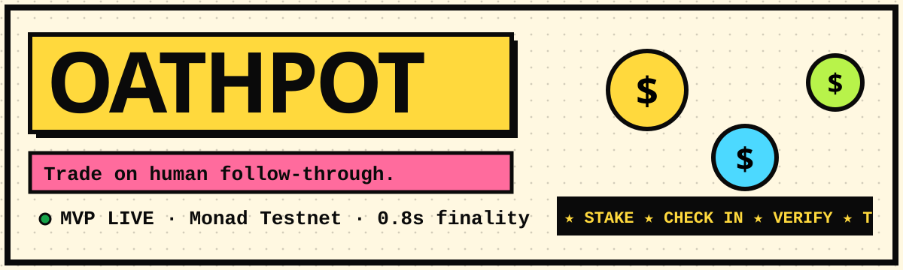
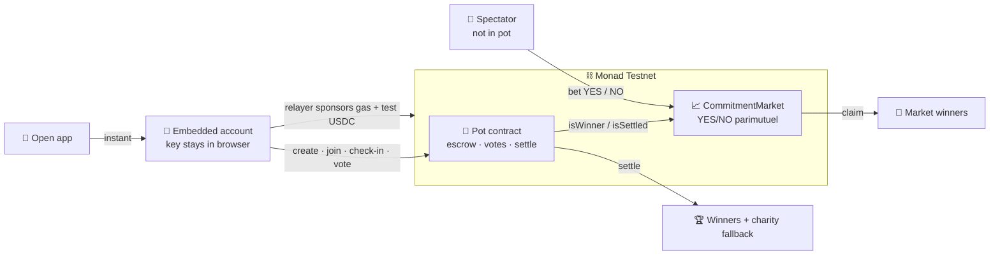

<div align="center">



<a href="https://git.io/typing-svg"></a>

<br/>


### [🚀 **Live MVP**](https://www.youtube.com/watch?v=yjco21XvzUE&feature=youtu.be) · [🎬 Demo script](DEMO_SCRIPT.md) · [🧱 Architecture](#-how-our-solution-works) · [🛠 Deploy](https://oath-pot.vercel.app/)

</div>

---

## 📑 Contents
[Problem](#-problem-statement) · [Solution](#-what-is-our-solution) · [How it works](#-how-our-solution-works) · [Why ours](#-why-our-solution) · [Uniqueness](#-uniqueness) · [Why users love it](#-why-users-will-love-it) · [Scalability](#-scalability) · [Tech stack](#-tech-stack) · [Research](#-research-existing-projects) · [Track fit](#-track-fit-onchain-finance--trading) · [Run & deploy](#-run-locally) · [Security](#-security--honest-limitations) · [Roadmap](#-roadmap) · [Team](#-team)

---

## 🎯 Problem Statement

> **People don't fail from a lack of goals. They fail from a lack of consequences — and nobody can price follow-through.**

| Pain | Reality today |
|---|---|
| 🙈 **No skin in the game** | Promises in a group chat cost nothing to break. |
| 🏦 **Custodial commitment apps** | Existing apps hold your money and decide disputes. You trust the company. |
| 🚫 **Markets ignore people** | Prediction markets price elections and sports — never *"will my friend actually go to the gym this week?"* |
| ⛽ **Crypto UX kills micro-stakes** | $5 stakes are impossible when gas, wallets and seed phrases come first. |

---

## 💡 What is our solution?

**Oathpot is a social commitment protocol with a built-in market.**

1. **Pots** — friends escrow equal stakes on a shared goal. Peers verify check-ins. Winners split what quitters forfeit; if everyone fails, it goes to charity.
2. **Commitment Markets** *(new primitive)* — for every member there is a YES/NO market: *"Will they hit their goal?"* Anyone **outside** the pot can back or fade them. The market settles **directly from the pot contract** — no oracle, no admin, no fee.

> A tradeable claim on a personal commitment — priced live as friends verify check-ins.

---

## 🧱 How our solution works



**Flow:** Start pot → friends join (stake escrowed) → check-in → **majority of *other* members** approve → spectators trade odds → deadline → `settle()` → pot pays winners → market resolves from `isWinner()` → traders `claim()`.

<details><summary><b>🔬 Market mechanics (click)</b></summary>

- **Parimutuel pool:** `payout = myStake × (yesPool + noPool) / winningPool`. Rounding never pays out more than the pool.
- **Implied probability:** `yesPool / (yesPool + noPool)`; the UI shows estimated payout *before* you bet.
- **Insider ban:** pot members cannot bet on their pot, so no one can bet NO on themselves and quit on purpose.
- **Edge cases:** if nobody backed the winning side, everyone is refunded. Betting closes at the pot's end date.
- **Isolation:** accounting is per-market — a bad pot address can never drain other markets.
</details>

---

## 🏆 Why our solution?

- **Aligned incentives, not trust:** money sits in contracts, not in a company's account.
- **Social proof as the oracle:** the hardest part of personal goals — *who decides?* — is solved by peer majority.
- **A market where none could exist:** pricing follow-through needs **sub-second finality**, otherwise odds lag reality.
- **Zero-crypto UX:** embedded accounts + sponsored gas make a **$2 stake** viable.

## 🦄 Uniqueness

| | Oathpot | Typical commitment app | Prediction market |
|---|:--:|:--:|:--:|
| Peer-verified goals | ✅ | ⚠️ referee/self-report | ❌ |
| Trustless escrow | ✅ | ❌ custodial | ✅ |
| **Trade on a *person's* outcome** | ✅ | ❌ | ❌ (public events only) |
| Live odds that react to check-ins | ✅ | ❌ | ⚠️ |
| No wallet / gas for user | ✅ | ✅ | ❌ |

**New primitive:** a *commitment share* — a claim whose underlying is verified human behaviour, with an on-chain, oracle-free resolution path.

## ❤️ Why users will love it

- 🔥 **It actually works** — real stakes + real friends = real follow-through.
- ⚡ **Instant** — open, stake, done. No installs, no gas prompts.
- 🎮 **It's a game** — leaderboard, XP, live activity feed, shareable result cards, a commitment-type quiz.
- 📈 **Spectators get a role** — friends who'd just heckle can now *back* you (or fade you) with skin in the game.
- 💚 **Feel-good fallback** — if everyone flops, charity wins.

## 📈 Scalability

| Layer | Today | Scaling path |
|---|---|---|
| **Chain** | Monad: 400 ms blocks, ~800 ms finality, cheap gas → micro-stakes viable | Same code runs on mainnet; batch calls via multicall |
| **Contracts** | Factory → one Pot per group; one market contract for **all** pots (keyed by `pot, member`) | Add fee switch, order-book/AMM pricing, ERC-4626-style market-maker vaults |
| **Reads** | Direct RPC polling | Indexer (Ponder / The Graph) + SSE for live odds |
| **Relayer** | Stateless route, rate-limited | Queue + Redis limiter; later ERC-4337 paymaster / passkey accounts |
| **Frontend** | Next.js on Vercel edge/CDN, static landing | ISR for public pot pages, OG share cards |
| **Assets** | Mock USDC | Real USDC, yield-bearing stakes, tokenized-equity stakes |

## 🛠 Tech stack

| Area | Tools |
|---|---|
| Smart contracts | Solidity 0.8.24, OpenZeppelin 5 (`SafeERC20`, `ReentrancyGuard`), Hardhat |
| Chain | Monad Testnet (chain id 10143) |
| Frontend | Next.js 16 (App Router, Turbopack), React 19, TypeScript, Tailwind CSS 4 |
| Web3 | viem 2 (public/wallet clients, embedded keys) |
| UX | Neo-brutalist design system, CSS 3D (cube, tilt, parallax), canvas-confetti |
| Hosting | Vercel (frontend + serverless relayer route) |

## 🔍 Research: existing projects

| Project | What it does | Gap Oathpot fills |
|---|---|---|
| **StickK** | Commitment contracts with optional referee; stakes may go to charity/anti-charity. | Funds are held by a company; no spectator market. |
| **Beeminder** | Pledges that escalate when you go off-track against tracked data. | Card-charged, solo-centric, no peer verification or trading. |
| **Habitica** | Gamified habit tracker; no real money. | No financial consequence. |
| **Kickback** | Event deposits returned to attendees (no-show pays). | Event attendance only; no ongoing goals or markets. |
| **Polymarket / Augur** | Prediction markets on public events. | Don't cover private/personal commitments; wallet-heavy UX. |
| **Group chats / gym buddies** | Informal accountability. | Zero stakes, zero enforcement. |

> Descriptions are based on public product pages at time of research and may be outdated.

## 🎯 Track fit: Onchain Finance & Trading

| Judging criterion | How Oathpot answers it |
|---|---|
| **Technical execution** | Escrow, voting, settlement and a parimutuel market run on-chain. 14 contract tests (pot rules, majority voting, all-fail/all-succeed/dust settlement, market pro-rata, insider ban, refund path, rounding) plus a scripted end-to-end run of the real app code against a local chain. |
| **Design & craft** | Odds, pool sizes and estimated payouts shown before every bet; explicit **risk disclosures** on create / join / trade. |
| **Originality** | A *commitment share* primitive resolved by peer-verified, on-chain behaviour — not a faster clone of an existing DeFi product. |
| **Founder & market readiness** | First user: student friend groups & campus clubs already using group chats for accountability. |
| **Traction & path** | Testnet MVP + simulated trades; pilot target of 5 groups / 40 users / 200 test trades; roadmap below. |

---

## 🌐 Live demo / judge access

- **Live URL:** `https://<your-project>.vercel.app` ← *replace after deploying*
- **No login needed** — an account, gas and test USDC are created automatically.
- **60-second path:** see [`DEMO_SCRIPT.md`](DEMO_SCRIPT.md). Tip: Account menu → **Add test friend** lets one person play every role.
- Network: Monad Testnet · Explorer: https://testnet.monadscan.com

## 🖥 Run locally

```bash
git clone <your-repo> && cd <your-repo>/frontend
cp .env.example .env.local      # fill in values (see below)
npm install
npm run dev                     # http://localhost:3000
```

**Contracts** (Hardhat 2, in `/contracts`):

```bash
cd contracts && npm install
cp .env.example .env            # add DEPLOYER_KEY=0x<throwaway testnet wallet>
npx hardhat test                # 14 passing
npx hardhat run scripts/deploy.js --network monadTestnet
# → prints NEXT_PUBLIC_MOCK_USDC / POT_FACTORY / DEMO_POT / MARKET_ADDRESS — paste into .env.local and Vercel
```

## 🚀 Deploy to Vercel

1. Push the repo to GitHub (`.gitignore` already excludes `node_modules`, `.next`, keys and `.env*`).
2. **Vercel → Add New → Project →** import the repo, set **Root Directory = `frontend`** (framework auto-detects as Next.js).
3. Add **Environment Variables** (Production + Preview):

| Variable | Scope | Value |
|---|---|---|
| `RELAYER_PRIVATE_KEY` | **Server only** | Fresh wallet funded with MON from the Monad faucet |
| `NEXT_PUBLIC_MOCK_USDC` | public | Deployed MockUSDC address |
| `NEXT_PUBLIC_POT_FACTORY` | public | Deployed PotFactory address |
| `NEXT_PUBLIC_DEMO_POT` | public | (optional) demo pot address |
| `NEXT_PUBLIC_MARKET_ADDRESS` | public | CommitmentMarket address |
| `NEXT_PUBLIC_RPC_URL` / `NEXT_PUBLIC_EXPLORER_URL` | public | optional overrides |

4. **Deploy.** The dashboard shows a red banner if the configured contracts aren't found on-chain — a quick sanity check.
5. Keep the relayer wallet topped up with testnet MON (each new user gets 0.25 MON).

> ⚠️ The addresses hard-coded as fallbacks are Hardhat-**local** addresses. They will not exist on Monad — always set the env vars.

## 🔐 Security & honest limitations

- Relayer **only** sponsors gas and mints *test* USDC; it never signs user actions. Input validation + in-memory rate limits (move to Redis for production).
- Embedded keys live in browser `localStorage` — **back them up** (Account → Backup key). Passkeys are on the roadmap.
- Photos are fingerprinted (hash) on-chain but not stored; friends verify via the note today.
- Market resolves from whatever pot address a bettor chooses; the UI only lists factory-created pots, and per-market accounting bounds the damage of a hostile pot.
- Demo pots expose a fast-forward button for testing — leave "Demo pot" **off** for real pots.
- **Not audited. Testnet funds only.**

## 🗺 Roadmap

- [x] Pots, friend-majority verification, charity fallback
- [x] Gasless embedded accounts
- [x] **Commitment Markets**, leaderboard, live activity feed
- [ ] Passkey login · photo-proof storage · indexer for live odds
- [ ] Campus pilot: 5 groups / 40 users / 200 test trades
- [ ] Audit → real USDC on mainnet · fee switch · market-maker vaults
- [ ] Yield-bearing and tokenized-equity stakes (stake earns while locked)

## 👥 Team

| | Name | Role | Links |
|---|---|---|---|
| 👨‍💻 | **Anand Minejes** | Founder · Product & Full-stack | [GitHub](https://github.com/Anand2k29) |
| 🛡️ | **Jyotasana** | Smart contracts & Security | [GitHub](https://github.com/Jyotasana17) |


---

<div align="center">

**🍯 Oathpot** — put your money where your streak is.


</div>
